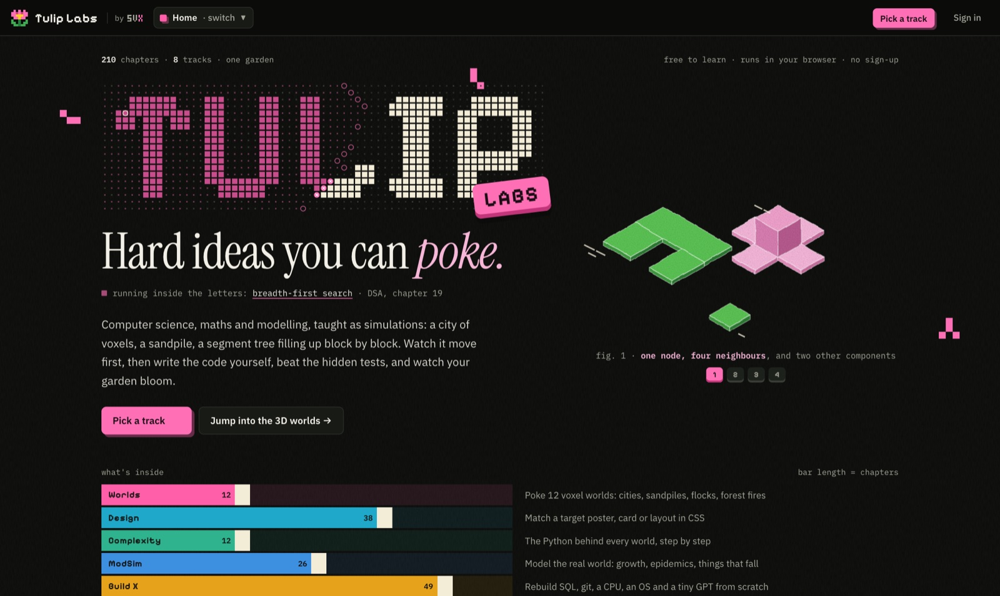
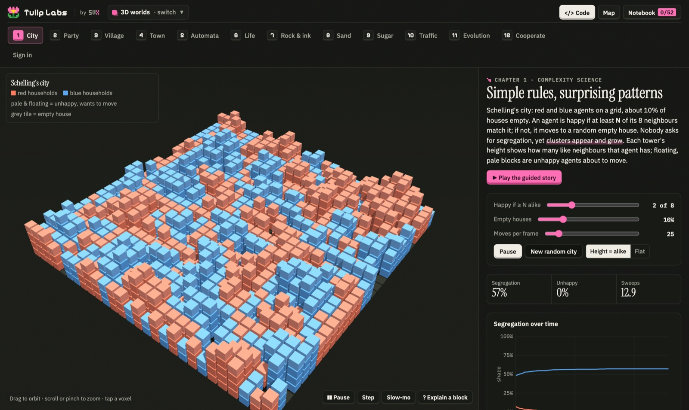
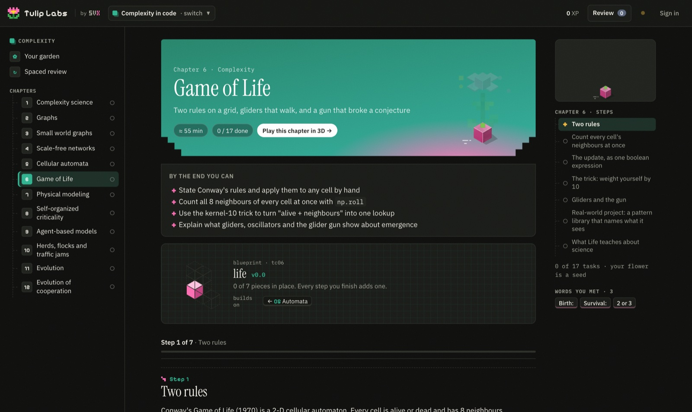
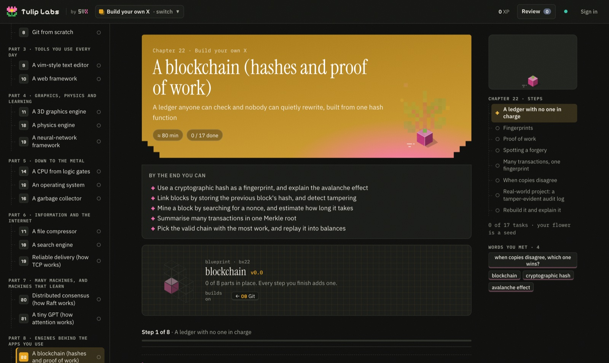
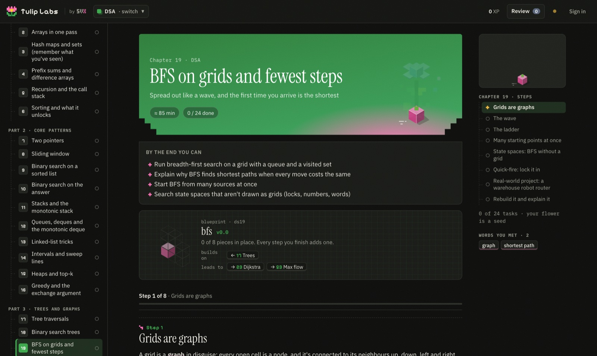
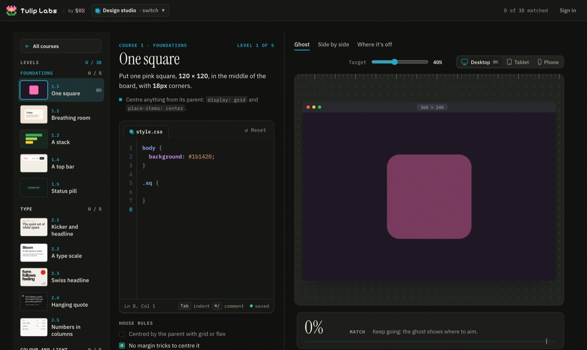
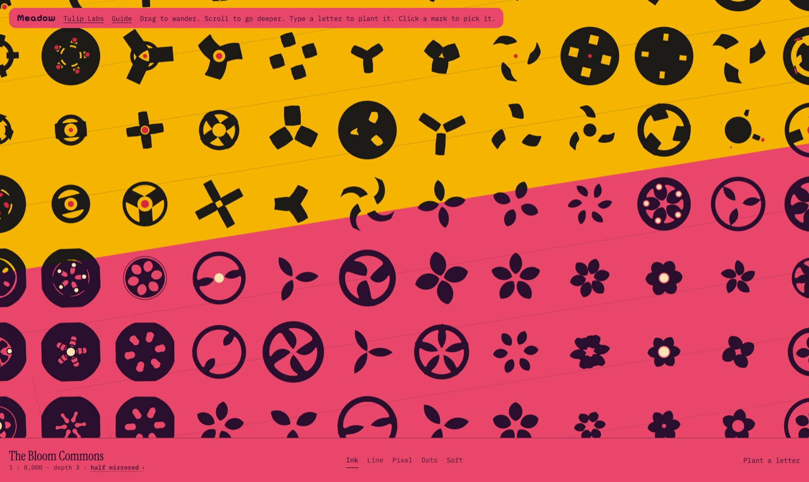
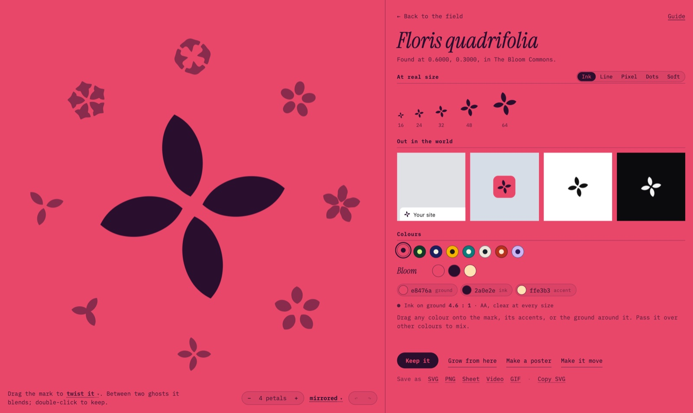

<div align="center">

# Tulip Labs

### Hard ideas you can poke.

Computer science, maths, modelling and design, taught as living simulations.
Do it by hand, watch it run, then build it yourself, all in the browser.

**[tuliplabs.srivtx.xyz](https://tuliplabs.srivtx.xyz)** &nbsp;·&nbsp; free to learn &nbsp;·&nbsp; nothing to install &nbsp;·&nbsp; a product by svx

<br>



</div>

---

## At a glance

| | |
|---|---|
| **8 tracks, 210 chapters, plus Meadow and Eye** | From voxel worlds and CSS design to databases, CPUs, statistics and algorithms, a generative studio for marks, and experiments in what looks good |
| **Everything runs in the tab** | Real Python (NumPy, SciPy, pandas, NetworkX, Matplotlib, SymPy), WebGL 3D and a code editor, with no installs and no servers to wait on |
| **Every lesson is machine-checked** | Thousands of blocks are run and graded before each release, then walked end to end in a real browser |
| **Private by design** | No ads, no trackers, no analytics. Learn without an account; sign in only if you want sync |

---

## The tracks

<table>
<tr>
<td width="50%" valign="top">

### 🌐 3D Worlds · 12 worlds
A segregating city, a party that links up all at once, a village with one shortcut, a sandpile that tunes itself, a highway jam that drives backwards, evolution, cooperation. Each world is a guided story: you act first, predict, then watch the model run.

</td>
<td width="50%" valign="top">

### 🎨 Design · 7 courses, 38 levels
Write CSS until your board matches a target poster, card or interface. A ghost overlay, a side-by-side view and a "where it's off" map show how close you are, pixel by pixel, across desktop, tablet and phone sizes.

</td>
</tr>
<tr>
<td valign="top">

### 🧬 Complexity in code · 12 chapters
The Python behind every world: graphs and search, small worlds, scale-free networks, cellular automata, Life, percolation, sandpiles, agents, flocks and evolution.

</td>
<td valign="top">

### 📈 Modeling & Simulation · 26 chapters
Bike share, world population, epidemics and interventions, cooling coffee, glucose and insulin, projectiles with drag, turntables and a bungee jump. You build every model and then question it.

</td>
</tr>
<tr>
<td valign="top">

### 🛠 Build your own X · 49 projects
A language and bytecode VM, a regex engine, a database on a B-tree, git, a vim-style editor, a web framework, a 3D engine, a physics engine, a neural-network framework, a CPU from logic gates, an operating system, a garbage collector, TCP, Raft, a tiny GPT, a blockchain, a ray tracer and more.

</td>
<td valign="top">

### 🎲 Probability & Stats · 13 chapters
Counting and chance, Bayes, distributions, the central limit theorem, sampling bias, intervals, hypothesis tests, regression, Bayesian inference and MCMC, ending in an honest A/B test.

</td>
</tr>
<tr>
<td valign="top">

### 🌲 DSA · 60 chapters
From Big-O to Codeforces, one pattern at a time: two pointers, sliding windows, monotonic stacks, trees, graphs, DP, segment trees and flows. Each pattern is shown in 3D first, then drilled with interview-style problems.

</td>
<td valign="top">

### 🌸 Meadow
An endless, walkable map of generated marks. Wander it, open any mark to shape it, and take it away as a logo, a full icon set, a poster or an animation. [More below.](#meadow)

</td>
</tr>
</table>

The eighth track, **Structures** (build every classic data structure yourself), is in progress.

---

## How it teaches



**The worlds follow one loop:**
1. **Do it by hand.** Before anything runs you do the agent's job: move an unhappy household, introduce two guests, drop a grain of sand.
2. **Predict, then watch.** Lock in a guess, run the world, and you're graded against what happened in *your* run, never a canned answer.
3. **Name it last.** Terms like *emergence* or *phase transition* appear only once you've seen the thing happen.
4. **Ask why, anywhere.** Turn on *Explain a block*, tap any voxel, and the world pauses to show the rule behind it, with real numbers.

**What's around the stories:**
- a time bar to pause, step a tick at a time or run in slow motion;
- a notebook that collects 52 ideas as you meet them;
- a map of how the ideas connect;
- a quiz drawn from what you've played;
- free play with sliders and live charts.

<br>



**Every coding chapter climbs the same ladder:**
1. **Run** working code and change it.
2. **Predict** what a program prints, then check.
3. **Reorder** scrambled lines (Parsons puzzles), sometimes with a decoy.
4. **Fill the blanks** in a working skeleton.
5. **Hunt the bug** in code that runs but is wrong.
6. **Write it** from a blank function, graded by tests that say which check failed and why.
7. **Rebuild it from memory**, then explain it in your own words.

**Around the ladder:**
- **Your code runs the show.** When an exercise passes, *your* function drives the animation: your `life_step` fires the glider gun, and your `lowest_point` designs the bungee cord.
- **A blueprint** shows each chapter as the pieces you'll build, and how it builds on earlier chapters and leads to later ones.
- **Real-world projects** come with a brief, milestones and a graded exercise.
- **Spaced review** brings everything back after 1, 3, 7, 16 and 35 days, with a blank starter rather than your old answer.
- **Your garden:** XP, a daily streak and a pixel flower per chapter that grows from seed to bloom as you finish tasks.

<p>


</p>



**The design studio** grades your CSS against a target:
- a live match score;
- house rules that reward good habits ("centred by the parent with grid or flex");
- a slider that fades the target in and out over your work.

---

## Meadow



Meadow is an endless map of marks: every mark is different, and the ones side by side are related.

**In the field:**
- **Explore:** drag to wander, and scroll to go deeper as new marks grow between the ones you can see.
- **Colours by place:** every region has its own palette.
- **Plant a letter** and the meadow grows marks shaped around it, ready for a monogram.
- **Five looks:** see every mark as Ink, Line, Pixel, Dots or Soft.



**In the studio:**
- **Shape it by dragging the mark:** twist, stretch, lean, petal shape, frame, colour, or draw on it.
- **Drawing:** lines round the mark, just where you draw, or mirrored side to side, top to bottom or four ways. Straight lines snap to 15°, and shapes close and fill.
- **Ghosts:** a ring of near versions of your mark. Point between two to blend them; click one to become it.
- **Proof at every size:** live previews from a 16 px favicon up, plus a browser tab, a phone, print and on black.
- **Colours** with a live ink-on-ground contrast check.
- **Take it with you:**
  - SVG, PNG, a brand sheet, video or GIF;
  - every icon a website needs, with its colours as CSS and design tokens;
  - posters in four styles, and moving marks that loop through their kin.
- **Keep and breed:** kept marks wait on a shelf, and dragging one onto another opens a nursery of every mix of the two.
- **Every mark is a link:** the address bar always holds the exact mark, so you can share it.

**Built for speed:** WebGL2 draws every mark with a shader. New ground is checked on the GPU in the background, so wandering, zooming and dragging hold 60 fps.

---

## Eye

Eye asks what *looking good* even means, one experiment at a time. You answer each one by hand, then see what your eye did against the maths.

- **Shape:** find the middle of a triangle, make a circle look as big as a square, space letters evenly, cut a rectangle, steady a frame, and stop when a broken circle becomes a circle.
- **Colour:** pick the fourth colour that belongs with three.
- **Motion:** shape a move until it feels natural, time a panel's opening, and tune a spring's bounce.
- **Endless:** after the set, a new shape every time (blobs, petals, polygons, rings and letters). Its truths are measured from its own pixels, so every question works on every shape. Each answer teaches a small model of your eye, which guesses your next answer before you give it.
- **Your eye:** every answer drawn small with its maths, and what Endless has learnt about you, in words. Everything stays in your browser.

---

## Quality

Tulip Labs ships nothing it hasn't run.

- **Every block is executed before release.** `tools/build.py --verify` runs every chapter in CPython:
  - every example runs, and every prediction is deterministic;
  - every reference solution passes its tests, and every starter fails them;
  - every Parsons answer and every "your code, running" reveal works.
- **Every chapter is walked in a browser.** `tools/e2e.js` steps through each one in Chromium with software WebGL, solving each task as a learner would.
- **Numbers come from real runs.** Any figure quoted in a lesson was checked against a run, and results in the worlds are computed live from yours.
- **Built to keep working:**
  - the Python worker retries on a second CDN mirror;
  - runaway loops have a Stop button;
  - a failed start is forgotten, so the next Run tries again.

---

## Privacy and accounts

- **No ads, no trackers, no analytics**, on any page.
- **No account needed.** Progress, notes and saved marks stay in your browser.
- **Optional sign-in** with Google or GitHub syncs your progress across devices. You can download your data or delete your account yourself.
- **Policies in plain words:** [privacy](https://tuliplabs.srivtx.xyz/privacy/), [terms](https://tuliplabs.srivtx.xyz/terms/), [refunds](https://tuliplabs.srivtx.xyz/refunds/) and [credits](https://tuliplabs.srivtx.xyz/credits/).

## Pricing

Learning is **free forever**. **Pro** will add unlimited AI hints, the full puzzle library and a portfolio; it isn't open yet. See [pricing](https://tuliplabs.srivtx.xyz/pricing/).

---

## Under the hood

| Layer | What it uses |
|---|---|
| Pages | Static HTML, CSS and JavaScript; no framework and no build step for the site |
| Lessons | Markdown in `content/`, compiled to JSON by `tools/build.py` |
| Python | [Pyodide](https://pyodide.org/) in a Web Worker |
| 3D | [Three.js](https://threejs.org/); each world draws through one instanced mesh, so tens of thousands of voxels stay smooth |
| Meadow | Hand-written WebGL2: signed-distance shaders, GPU readback for judging marks, one-pass preview atlases |
| Accounts | Supabase (Google and GitHub sign-in), optional |
| Look | One shared top bar and footer (`learn/nav.js`), light and dark themes that follow your system |

```
├── index.html              home
├── worlds/                 3D worlds
├── design/                 design courses and studio
├── code/ modsim/ build/ stats/ dsa/ ods/   coding tracks
├── meadow/                 Meadow (one file)
├── learn/                  lesson engine, editor, Python worker, 3D simulations, garden
├── content/                lessons as Markdown, built to JSON
├── tools/                  build + verify, dev server, browser tests, news
├── account/ pricing/ news/ privacy/ terms/ refunds/ credits/
└── docs/                   README images and notes
```

## Run it locally

```bash
git clone https://github.com/srivtx/tuliplabs.git
cd tuliplabs
python3 -m http.server 8000
```

Then open <http://localhost:8000>.

**To work on lessons:** edit `content/<track>/chNN.md` (the format is in [`content/FORMAT.md`](content/FORMAT.md)), then rebuild and check every block:

```bash
python3 tools/build.py --verify
```

This needs numpy, scipy, networkx, pandas and matplotlib.

**To test with a local Python runner:**

```bash
python3 tools/devserver.py 8000
```

Then open <http://localhost:8000/code/?runner=local>.

**To walk a chapter in a real browser** (needs Playwright):

```bash
node tools/e2e.js code 6
```

---

<div align="center">

Code is released under the [MIT License](LICENSE). Built by [svx](https://github.com/srivtx).

</div>
