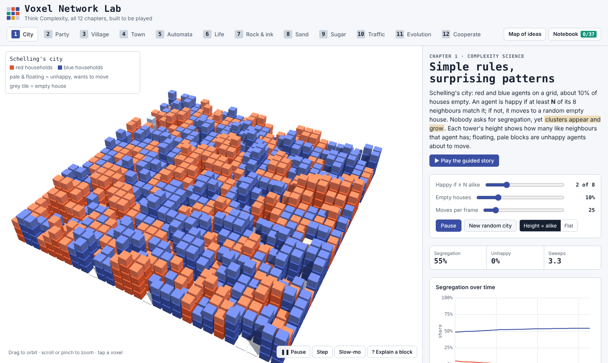
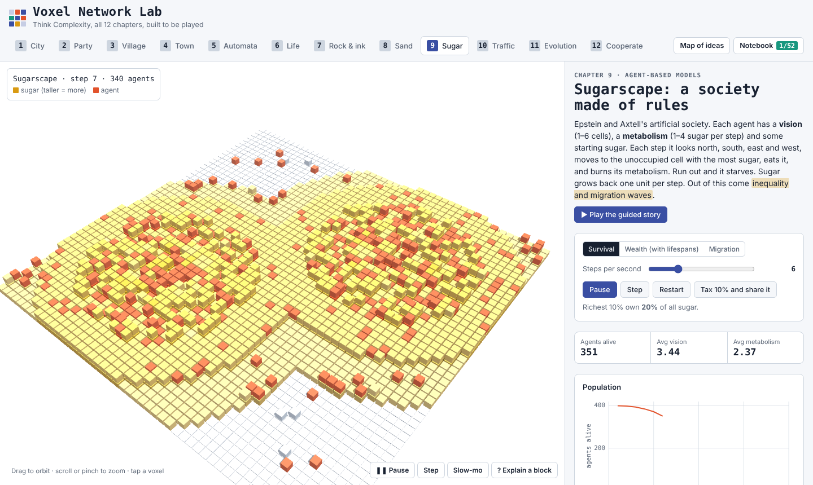
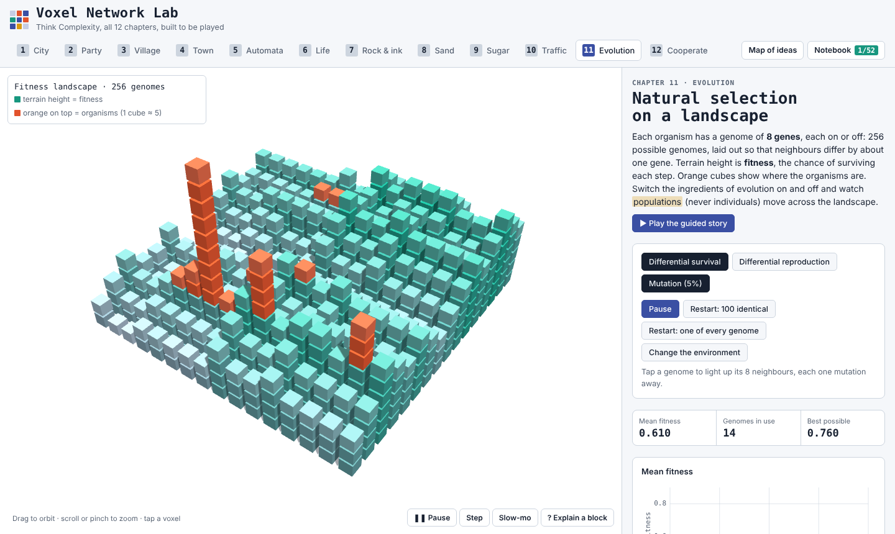

# Tulip Labs

*Formerly Voxel Network Lab. A product by svx.*

**Learn complexity science by playing with it, then by coding it.** All 12 chapters of Allen B. Downey's *[Think Complexity](https://greenteapress.com/wp/think-complexity-2e/)* (2nd edition), rebuilt as interactive 3D voxel worlds. You move the households, host the party, drill the rock and drop the sand yourself, and only then does the computer run the model.

**Live:** https://tuliplabs.srivtx.xyz · **Code tracks:** [/code](https://tuliplabs.srivtx.xyz/code/) (Think Complexity), [/modsim](https://tuliplabs.srivtx.xyz/modsim/) (Modeling and Simulation in Python), [/build](https://tuliplabs.srivtx.xyz/build/) (Build your own X) and [/stats](https://tuliplabs.srivtx.xyz/stats/) (Probability & Stats)



---

## Why this exists

Reading about emergence is not the same as watching it happen. Most textbook figures are a single frame of a moving system, and most explanations ask you to trust a conclusion you never checked yourself.

This lab is built around a different loop:

1. **Play it by hand.** Before any simulation runs, you do the agent's job yourself: move an unhappy household, introduce two guests, place a shortcut across a lake, choose your friends as a newcomer.
2. **Predict, then watch.** Each story asks you to lock in a guess first ("How many of the 400 agents survive?"). Then the world runs and grades you against what actually happened in *your* run, never against a canned answer.
3. **Name it last.** Words like *emergence*, *phase transition* or *self-organized criticality* only appear after you've seen the thing happen.
4. **Ask "why?" anywhere.** Turn on **Explain a block**, tap any voxel, and the world pauses to show the rule behind that one block, with the real numbers.

---

## The 12 worlds

| # | World | Chapter idea | What you do |
|---|-------|--------------|-------------|
| 1 | **City** | Complexity science, Schelling's segregation model | Inspect neighbourhoods, move unhappy households by hand, then test how a mild preference splits a city |
| 2 | **Party** | Random graphs (Erdős–Rényi), connectivity | Link 12 guests by hand, compare with random chatting, find the tipping point *p\* = ln(n)/n* |
| 3 | **Village** | Small-world graphs (Watts–Strogatz), BFS | Send a letter around a lake, then place one shortcut to get it there in 8 hand-offs or fewer |
| 4 | **Town** | Scale-free networks (Barabási–Albert) | Join as a newcomer, draw lottery tickets, watch hubs grow, test growth without popularity |
| 5 | **Automata** | 1-D cellular automata, Wolfram's classes | Predict the next row by hand, write your own rule table, sort rules 0/18/30/110 into classes |
| 6 | **Life** | Conway's Game of Life | Predict births and deaths, build a glider, fire the glider gun that disproved Conway's conjecture |
| 7 | **Rock & ink** | Percolation, fractals, reaction–diffusion | Drill through rock, find the critical porosity (≈ 0.593), measure a fractal dimension, grow Turing spots |
| 8 | **Sand** | Self-organized criticality | Trigger avalanches by hand, collect 3,000 of them, watch the pile tune itself, pour a fractal mandala |
| 9 | **Sugar** | Agent-based models (Sugarscape) | Survive as one agent, watch inequality emerge, try a tax, see migration waves move diagonally |
| 10 | **Traffic** | Traffic jams and Boids | Tap your brakes to start a backward-moving jam, design a better driver, steer a flock |
| 11 | **Evolution** | Fitness landscapes, selection, mutation | Switch the ingredients of evolution on and off, change the environment, watch a new species form |
| 12 | **Cooperate** | Prisoner's dilemma, evolution of cooperation | Play mystery opponents, build a 7-gene strategy, evolve cooperation from pure defectors |

<p align="center">
  
  
</p>

---

## Teaching features

- **Guided stories:** every chapter has a step-by-step story (about 8–11 steps) with hands-on tasks, predictions and live results. Click a progress dot to revisit a step; arrow keys move forward and back.
- **Explain a block:** pause the world and see the rule behind any single voxel: a household's ✓/✗ neighbours, a Life cell's neighbour count, where a Sugarscape agent will move next, each gene's contribution to fitness.
- **Time bar:** pause, step one tick at a time, or slow everything to a quarter speed.
- **Think it through:** each story ends with application questions (not recall), each with an explanation.
- **Notebook:** 52 ideas collected in plain words as you meet them, saved in your browser.
- **Map of ideas:** every concept laid out by chapter, with lines showing where an idea returns. For example, the party's tipping point is the same shape as percolation's critical point, and the sand pile finds that point by itself.
- **Quiz me:** a mixed review round drawn from the chapters you've played.
- **Free play:** every world also has its own controls, sliders and live charts for open-ended experiments.

---

## Learn it in code

Playing a world shows you *what* happens. The code tracks teach you to *build* it. There are four courses on one engine, with real Python running in the browser (Pyodide: numpy, networkx, matplotlib, scipy, pandas, sympy) and nothing to install:

| Track | Chapters | What you build |
|---|---|---|
| **[Think Complexity in code](https://tuliplabs.srivtx.xyz/code/)** | 12 | `all_pairs` → Erdős–Rényi graphs, Watts–Strogatz and BFS, Barabási–Albert, rule tables and Rule 30, Life, percolation and Turing patterns, the sand pile, Schelling and Sugarscape, traffic and boids, evolution, the prisoner's dilemma |
| **[Modeling & Simulation in Python](https://tuliplabs.srivtx.xyz/modsim/)** | 26 | bike share, world population, SIR epidemics and interventions, coffee cooling, the glucose minimal model, falling pennies with drag, baseballs, toilet paper, turntables, bungee jumps |
| **[Build your own X](https://tuliplabs.srivtx.xyz/build/)** | 29 | object modeling (an elevator), a calculator, a math engine, a programming language and bytecode VM, a regex engine, a key-value database, a tiny SQL database on a B-tree, git, a vim-style editor, a web framework, a 3D graphics engine, a physics engine, a neural-network framework, a CPU from logic gates, an operating system (scheduler and virtual memory), a garbage collector, a file compressor (Huffman), a search engine (inverted index and TF-IDF), reliable delivery (how TCP works), distributed consensus (Raft), a tiny GPT (attention), a blockchain (hashes and proof of work), a spreadsheet engine (dependency graphs), a ray tracer, a distributed cache (LRU and consistent hashing), a diff tool (LCS), a build system (like make), a package manager (version resolution), a test framework (like pytest) |
| **[Probability & Stats](https://tuliplabs.srivtx.xyz/stats/)** | 13 | chance and counting, conditional probability and Bayes, random variables, binomial and Poisson, the normal and the CLT, sampling bias, confidence intervals, hypothesis tests, regression, Bayesian inference, Markov chains and MCMC, an honest A/B test |

Every chapter opens with an **interactive 3D simulation** where each part explains *why* it was designed that way (click any block), and has a **real-world project** step: a brief, why it matters, milestones you tick off, and a graded exercise.

### How a chapter teaches

Every chapter is a **step-by-step path**. A step opens with the idea in plain words, then gives you a task; the next step unlocks when you finish it (or choose "skip for now"). The tasks climb a ladder designed so the material sticks:

1. **Run** the book's code and change it.
2. **Predict** the output: type your guess, then run it and compare.
3. **Reorder** scrambled lines (Parsons puzzles), sometimes with a decoy line.
4. **Fill the blanks** in a working skeleton.
5. **Bug hunt:** code that runs but is wrong, usually a mistake people really make.
6. **Write it** from a blank function, graded by tests that tell you which check failed and why.
7. **Rebuild from memory, then explain** the idea in your own words and compare with a model answer.

Then, **your code, running:** when an exercise passes, its reveal uses *your* function to drive an animation or plot. The glider gun fires on your `life_step`, water seeps through rock with your `percolates`, a jam drives backward on your traffic `step`, and the bungee cord is designed by your `lowest_point`. Grids animate as flipbooks with play, pause and a scrubber.

Everything you finish joins a **spaced-review** deck (Leitner boxes: back after 1, 3, 7, 16 and 35 days), and exercises come back with a blank starter, not your old answer. XP, a daily streak and a chapter-complete screen show your progress. Each Think Complexity chapter links to its 3D world and back.

### Verified, not just written

`python3 tools/build.py --verify` runs every block of every chapter in CPython before it ships:
- every example runs;
- every prediction is deterministic;
- every reference solution passes its tests, and every starter fails them;
- every Parsons answer and every "your code, running" reveal works.

Numbers quoted in lessons were checked against the run: the sand pile settles at an average height of about 2.08, Sugarscape keeps about 225 of 400 agents, cooperation evolves from all-defectors to about 0.56 niceness, a penny with drag lands at 18 m/s after about 22 s, and the Green Monster needs about 41 m/s. `tools/e2e.js` then walks every chapter in a real browser, step by step, solving every task.

Honest notes: the ModSim library is reimplemented as a short, readable [`learn/modsim.py`](learn/modsim.py) with the book's function names but no Pint units. The glucose chapters use **synthetic** data generated from the minimal model, because the original dataset isn't bundled. The world population data are rounded Census estimates. Chapter 9's SymPy example runs in the browser but is skipped by the CPython verifier when SymPy isn't installed.

---

## Is it faithful to the book?

The simulations follow the models as the book describes them. Key numbers were checked by running the models headless before the stories were written:

| Check | Book | This lab |
|-------|------|----------|
| Sugarscape survivors after 100 steps (from 400) | ≈ 250 | ≈ 241 |
| Percolation critical porosity | ≈ 0.59 | jump between 0.55 and 0.65 |
| Fractal dimension of the percolating cluster | ≈ 1.85 | ≈ 1.87–1.89 |
| Sand pile average height in steady state | – | ≈ 2.07 |
| Traffic: 20 cars, no noise | all at speed 40 | 40.0 |

Where the stories quote a result, it is computed live from your own run. One honest caveat: the book's version 2.6.4 notes a bug in the original code for Chapter 12. This lab uses the corrected rule (fitter agents more likely to *survive*), so cooperation rises and collapses in waves, and your runs may differ from the figures in older copies of the book.

---

## Controls

| Action | Mouse | Touch |
|--------|-------|-------|
| Spin the world | drag | drag |
| Zoom | scroll | pinch |
| Interact | click a block | tap a block |
| Move the Boids' carrot | click the ground | tap the ground |
| Next / previous story step | → / ← | buttons |

---

## Run it locally

The 3D lab is a single self-contained HTML file. The code tracks are static too; lessons are prebuilt into `content/*.json`.

```bash
git clone https://github.com/srivtx/tuliplabs.git
cd voxel-network-lab
python3 -m http.server          # then open / (home), /worlds/, /code/, /modsim/, /build/, /stats/, /dsa/ or /ods/
```

To edit lessons, change `content/<track>/chNN.md` (`tc`, `ms`, `bx` or `ps`) (format: [`content/FORMAT.md`](content/FORMAT.md)) and rebuild:

```bash
python3 tools/build.py --verify            # build + check every block (needs numpy, scipy, networkx, pandas, matplotlib)
python3 tools/devserver.py 8000            # serve with a local CPython runner
open "http://localhost:8000/code/?runner=local"
node tools/e2e.js code 6                   # walk a chapter in a real browser (Playwright, software WebGL)
```

---

## How it's built

- **Home page:** `index.html` draws everything in code (no image files): the title letters run BFS, Life and a sandpile, the figure is watercolour isometric voxels, and your progress lands on a glyph globe.
- **3D worlds in one file:** `worlds/index.html` holds all the markup, styles and JavaScript (~270 KB).
- **One top bar:** `learn/nav.css` and `learn/nav.js` give every page the same section switcher and footer, and fetch a section ahead while you hover it.
- **The garden:** `learn/garden.js` draws each chapter as a pixel flower that grows from seed to full bloom as you finish its tasks. Track pages are a poster plus beds of these flowers; each chapter has a stepped cover with its flower and, on wide screens, a rail of its steps.
- **Python that recovers:** the Pyodide worker retries on a second CDN mirror, and a failed start is forgotten so the next Run tries again.
- **3D:** [Three.js r128](https://threejs.org/), loaded from cdnjs. Every world draws through a single `InstancedMesh` of cubes, so tens of thousands of voxels stay smooth.
- **Charts:** a small hand-written canvas chart routine (linear and log-log axes).
- **No backend:** progress and the notebook live in `localStorage`; nothing is sent anywhere.
- **Code tracks:** Python via [Pyodide 0.26](https://pyodide.org/) in a Web Worker (with a Stop button for runaway loops), a small hand-written Python editor with highlighting and auto-indent.
- **Themes:** follows your system's light or dark mode.

```
voxel-network-lab/
├── index.html          # home page
├── worlds/             # the 3D lab
├── code/ modsim/ build/ stats/ dsa/ ods/  # the code-track pages
├── learn/
│   ├── nav.js/.css     # shared top bar switcher and footer
│   ├── garden.js       # the pixel flower each chapter grows
│   ├── engine.js/.css  # lesson renderer: editor, exercises, steps, review, flipbooks, sims, projects
│   ├── viz/            # one 3D simulation per chapter (core.js is the shared API)
│   ├── py-worker.js    # Pyodide in a Web Worker
│   ├── harness.py      # runs code, captures output/plots/animations, grades tests
│   ├── modsim.py       # readable ModSim library (book API)
│   └── complexity.py   # small helpers for Think Complexity
├── content/
│   ├── tc/ ms/ bx/ ps/ # lessons, one Markdown file per chapter
│   └── *.json          # built lessons
├── tools/              # build + verify, dev server, browser end-to-end test
├── docs/               # README screenshots
└── vercel.json
```

---

## Credits

- Models and chapter structure from **Allen B. Downey, *Think Complexity*, 2nd edition** (Green Tea Press / O'Reilly) and **Allen B. Downey, *Modeling and Simulation in Python*** (Green Tea Press). Both books are free to read at [greenteapress.com](https://greenteapress.com/). This project is an independent study companion, not affiliated with the author or publisher.
- Original models by Schelling; Erdős and Rényi; Watts and Strogatz; Barabási and Albert; Wolfram; Conway; Bak, Tang and Wiesenfeld; Epstein and Axtell; Resnick; Reynolds; Kauffman; and Axelrod.
- Built by [Sribatsha Dash (@srivtx)](https://github.com/srivtx).

## License

The code is released under the [MIT License](LICENSE).
